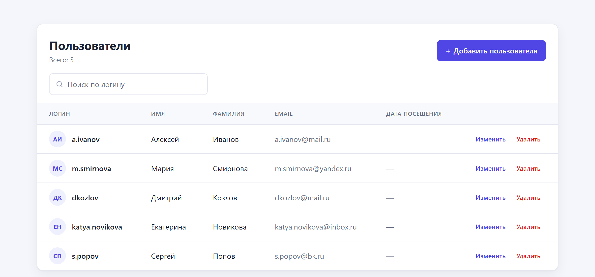
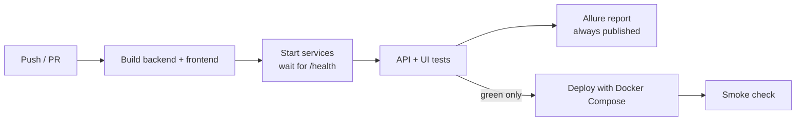

# User Management App — Test Automation

[](https://github.com/deniscyborg/UserManagementAppTests/actions/workflows/main.yml)


A small full-stack application and the C# test framework that guards it.
REST API and browser UI tests run on every push in GitHub Actions, the results are published
as an Allure report, and the app is deployed only when the whole suite is green.

| | |
|---|---|
| **Live demo** | https://usermanagementapp.com |
| **Project showcase** | https://report.usermanagementapp.com |
| **Allure report** | https://report.usermanagementapp.com/allure/ |



## Tech stack

| Layer | Tools |
|---|---|
| Tests | C#, .NET 10, NUnit 4, Playwright for .NET, Allure.NUnit |
| Backend | ASP.NET Core 10 Web API (in-memory storage) |
| Frontend | React 19, Vite |
| Infrastructure | Docker Compose, Nginx, GitHub Actions |

## Test strategy

**API tests** (`tests/Api`) cover the business rules quickly and in detail:
full CRUD for `/api/users`, validation errors (`400` with ProblemDetails), duplicate email
(`409`, case-insensitive), missing resources (`404`), the `Location` header and input trimming.

**UI tests** (`tests/Ui`) cover real user journeys in Chromium: adding, editing and deleting users,
client-side validation for every field, a server error surfaced in the UI, search and empty states,
cancel and keyboard flows.

Design principles:

- **Isolated data.** Every test creates its own users with unique emails and removes them in teardown,
  so tests are order-independent and run in parallel.
- **Fast arrange via API.** UI tests prepare data through the API and use the browser only for the
  behaviour under test.
- **Page Object model** with accessible locators (`GetByRole`, `GetByLabel`).
- **Debuggable failures.** A failed UI test attaches a full-page screenshot and a Playwright trace
  to the Allure report.
- **Honest CI.** Any failing test turns the build red and blocks the deployment; the report is still
  published, with history and trends across runs.

## Pipeline



## Project structure

```
backend/               ASP.NET Core Web API
  Controllers/         UsersController — /api/users
  Services/            in-memory repository
frontend/              React + Vite single-page app
tests/
  Api/                 REST API tests
  Ui/                  Playwright UI tests
  Pages/               Page Objects
  Infrastructure/      settings, API client, test data, base classes
showcase/              static project page published next to the Allure report
.github/workflows/     CI/CD pipeline
```

## Running locally

Requirements: .NET 10 SDK, Node.js 22, PowerShell (for the Playwright installer).

```sh
# 1. Backend on http://localhost:5006
dotnet run --project backend

# 2. Frontend on http://localhost:5173 (proxies /api to the backend)
cd frontend && npm ci && npm run dev

# 3. Tests
dotnet build tests
pwsh tests/bin/Debug/net10.0/playwright.ps1 install chromium
dotnet test tests
```

Test settings come from environment variables:

| Variable | Default |
|---|---|
| `BASE_URL` | `http://localhost:5173` |
| `API_BASE_URL` | `http://localhost:5006/api` |
| `BROWSER` | `chromium` (also `firefox`, `webkit`) |
| `HEADED` | unset — set to `1` to watch the browser |

To view the Allure report locally after a run:

```sh
allure serve tests/bin/Debug/net10.0/allure-results
```

## Author

**Denis Davydov** — SDET / QA Automation Infrastructure Engineer, Berlin.
[LinkedIn](https://www.linkedin.com/in/denis-davydov-72bb51338/)
